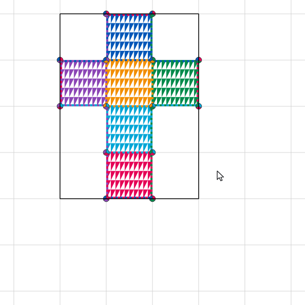

# Cube Net

## About

Cube Net is a desktop application that lets you build cube networks (simple polygons that, when folded,
can cover the whole surface of a cube without overlaps) by transforming one valid network into another
using cuts and rearrangements.

<!--
The animation is made by the application itself: scripts/make_readme_animation.py plays this cut with the real net
and tools, in the default look (with two exceptions: no vertex labels and bounding rectangle is ON), and records it.
Run it again whenever the default look changes: the default style (colours, sizes, tiling), how the sheet, the net,
the cut line and its buttons are drawn, or how the mouse pointer looks over them.
A test fails when the animation's first picture no longer matches the app.
-->
<p align="center">
  
</p>

In the application, **Help → Help** (F1) explains how it all works, with animations.

## Installation

Latest release is [here](https://github.com/Avorthoren/cube-net/releases/latest),
or pick any on [Releases page](https://github.com/Avorthoren/cube-net/releases).<br/>
Download the file for your system from release **Assets**. The application is free and needs nothing else installed.
Once installed, it looks for a newer version on GitHub once a day, when it starts (you can switch that off
in **Settings → Preferences**, and check any time with **Help → Check for updates**). When there's one,
**Download and update** downloads it, checks that it's the published file, installs it and restarts Cube Net.

The downloads are checked automatically when they're built, but they aren't *signed*: Windows and macOS only trust
programs signed with a certificate (Windows) or an Apple Developer account (macOS), which cost a yearly fee. The
author of this free application has chosen not to pay it, so both systems warn you the first time, as described below.
The source code of every release is on the same page, and the program is built from it by GitHub, in public: see the
[build runs](https://github.com/Avorthoren/cube-net/actions).

### Windows

Supported: **Windows 10 and Windows 11**, 64-bit (x64). Windows 11 on Arm should run it too, through its emulation of
x64 programs.

1. Download `CubeNet-<version>-windows-x64-setup.exe`. If the browser says the file isn't commonly downloaded, choose
   to keep it (in Edge: **⋯** → **Keep** → **Show more** → **Keep anyway**).
2. Run it. Windows shows **"Windows protected your PC"** (Microsoft Defender SmartScreen), because the installer isn't
   signed (see above). Click **More info**, then **Run anyway**. This happens only for the installer.
3. Follow the installer. It installs Cube Net for your user only, without administrator rights, and adds it to the
   Start menu (and to the desktop, if you tick that).

Project files (`.cubenet`) then open in Cube Net with a double-click. To update, install a newer version the same
way: it replaces the old one. To remove Cube Net, see [Uninstallation](#uninstallation).

### Linux

Supported: 64-bit (x86-64) distributions with **glibc 2.35 or newer**, for example **Ubuntu 22.04**, **Debian 12**,
**Fedora 36**, **Linux Mint 21** and anything newer, with X11 or Wayland. Arm computers aren't supported.

1. Download `CubeNet-<version>-linux-x86_64.AppImage`: the whole application in one file
   ([what's an AppImage](https://docs.appimage.org/introduction/quickstart.html)).
2. Allow it to run as a program: in the file manager, **Properties → Permissions → Allow executing file as program**,
   or in a terminal:
   ```bash
   chmod +x CubeNet-*-linux-x86_64.AppImage
   ```
3. Double-click it (or run `./CubeNet-<version>-linux-x86_64.AppImage`).

There's no signing to worry about. If it doesn't start and a terminal shows a message about FUSE, start it with
`./CubeNet-<version>-linux-x86_64.AppImage --appimage-extract-and-run`, or install your distribution's `fuse` package.

The first time it starts, Cube Net asks whether to add itself to the applications menu. With that, it's in the menu
and the Dock with its icon, and project files (`.cubenet`) open in it with a double-click (and in **Open With**). It
follows the AppImage: if you move the file, start it once from its new place, and everything points there again (until
then, the menu doesn't show it). You can change your mind any time: **Settings → Preferences → Show in the
applications menu**. Without it, open projects from the application (**File → Open**), or from a terminal:
`./CubeNet-<version>-linux-x86_64.AppImage path/to/project.cubenet`.

To update, download the newer AppImage and start it once: the menu entry switches to it. To remove Cube Net, see
[Uninstallation](#uninstallation).

### macOS

Supported: Macs with **Apple silicon** (M1 or later) and **macOS 14 Sonoma or newer**. Macs with Intel processors
aren't supported.

1. Download `CubeNet-<version>-macos-arm64.dmg` and open it.
2. Drag **Cube Net** onto **Applications**.
3. Open Cube Net from Applications. The first time, macOS refuses: *"Apple could not verify 'Cube Net' is free of
   malware"*. That's Gatekeeper, because the application isn't signed with an Apple Developer account and checked by
   Apple ("notarized"; see above). Click **Done**, then open **System Settings → Privacy & Security**, scroll down to
   *"Cube Net" was blocked…* and click **Open Anyway**, then confirm with your password. From then on it opens
   normally. (On macOS 14 you can also Control-click the application, choose **Open**, then **Open** again.)

The same in a terminal, after step 2:
```bash
xattr -dr com.apple.quarantine "/Applications/Cube Net.app"
```

Project files (`.cubenet`) then open in Cube Net with a double-click (or when dropped on its Dock icon). To update,
drag the newer version onto Applications the same way (and repeat step 3 once). To remove Cube Net, see
[Uninstallation](#uninstallation).

### Checking a download

Each release also has `SHA256SUMS`, with the checksum of every file. To check yours (Linux; on macOS use
`shasum -a 256 -c`):
```bash
sha256sum -c SHA256SUMS --ignore-missing
```

## Uninstallation

Removing the application leaves two things behind, on every system, in your user's folders only:

- **Its settings**: language, style, the settings panel's state, the window's size, the last project's location and
  the like. Installing Cube Net again later finds them and starts as you left it.
- **Session logs**, if logging was ever switched on (the record button on the instruments panel, or *Auto-start
  logging* in the settings; both off unless you used them): a small text file per session, for reproducing problems.

Your projects (`.cubenet` files) are wherever you saved them: uninstalling never touches them.

Delete the settings and the logs too, if you want nothing left.

### Windows

1. **Settings → Apps → Installed apps** (on Windows 10: **Settings → Apps → Apps & features**), find **Cube Net**,
   then **⋯** → **Uninstall**. This removes the program, its Start menu and desktop shortcuts, and the link between
   `.cubenet` files and Cube Net.
2. What's left:
   - the settings, in the registry: `HKEY_CURRENT_USER\Software\cube_net`;
   - the session logs: `%APPDATA%\cube_net` (that is `C:\Users\<you>\AppData\Roaming\cube_net`).

   To delete both, in PowerShell:
   ```powershell
   Remove-Item -Recurse -Force "HKCU:\Software\cube_net", "$env:APPDATA\cube_net" -ErrorAction SilentlyContinue
   ```

### Linux

1. If you let Cube Net add itself to the applications menu, take it out first: **Settings → Preferences**, untick
   **Show in the applications menu**. (Or later, by hand: delete `~/.local/share/applications/cube-net.desktop`,
   `~/.local/share/icons/hicolor/256x256/apps/cube-net.png` and `~/.local/share/mime/packages/cube-net.xml`.)
2. Delete the AppImage file.
3. What's left:
   - the settings: `~/.config/cube_net/Cube Net.conf`;
   - the session logs: `~/.local/share/cube_net/Cube Net/sessions`.

   To delete both, and the menu entry if it's still there:
   ```bash
   rm -rf ~/.config/cube_net ~/.local/share/cube_net
   ```
   ```bash
   rm -f ~/.local/share/applications/cube-net.desktop ~/.local/share/icons/hicolor/256x256/apps/cube-net.png ~/.local/share/mime/packages/cube-net.xml
   ```

### macOS

1. Quit Cube Net, then move **Cube Net** from **Applications** to the **Bin**, and empty the Bin.
2. What's left (in your Library folder, hidden in Finder: **Go → Go to Folder…**, then type the path):
   - the settings: `~/Library/Preferences/com.cube-net.Cube Net.plist`;
   - the session logs: `~/Library/Application Support/cube_net`;
   - possibly the windows' saved state: `~/Library/Saved Application State/io.github.avorthoren.cubenet.savedState`.

   To delete them, in Terminal (`defaults` removes the settings properly, as macOS keeps them in memory too):
   ```bash
   defaults delete "com.cube-net.Cube Net"
   ```
   ```bash
   rm -rf ~/Library/"Application Support"/cube_net ~/Library/"Saved Application State"/io.github.avorthoren.cubenet.savedState
   ```

## License

Copyright (C) 2026 Viktor Podust

This program is free software: you can redistribute it and/or modify it under the terms of the GNU General Public
License as published by the Free Software Foundation, either version 3 of the License, or (at your option) any later
version.

This program is distributed in the hope that it will be useful, but WITHOUT ANY WARRANTY; without even the implied
warranty of MERCHANTABILITY or FITNESS FOR A PARTICULAR PURPOSE. See the GNU General Public License for more details.

You should have received a copy of the GNU General Public License along with this program (the [LICENSE](LICENSE)
file). If not, see <https://www.gnu.org/licenses/>.

The application is built with [PyQt6](https://www.riverbankcomputing.com/software/pyqt/) (GNU GPL v3) and
[Qt](https://www.qt.io/) (GNU LGPL v3).
